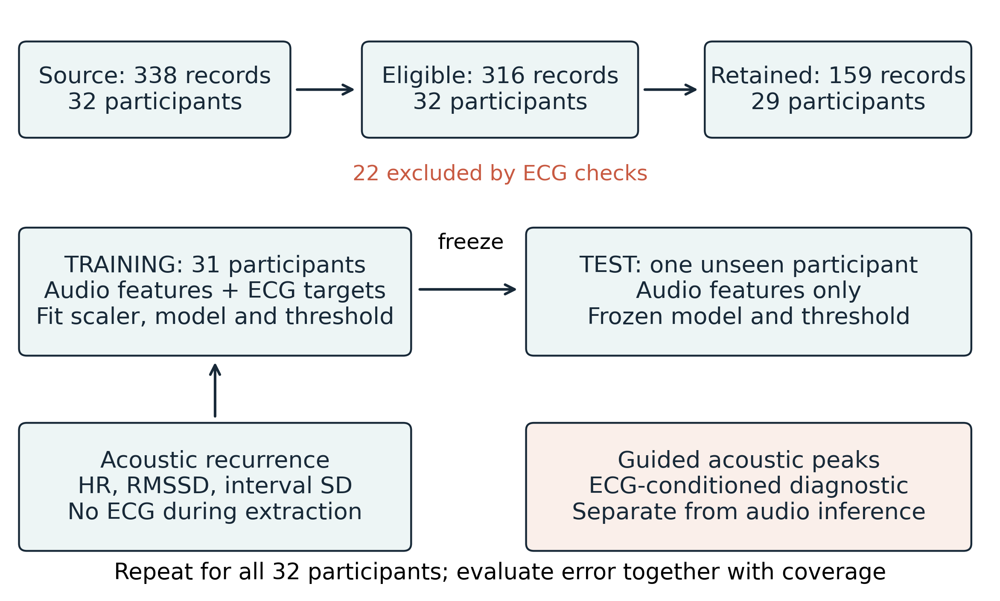
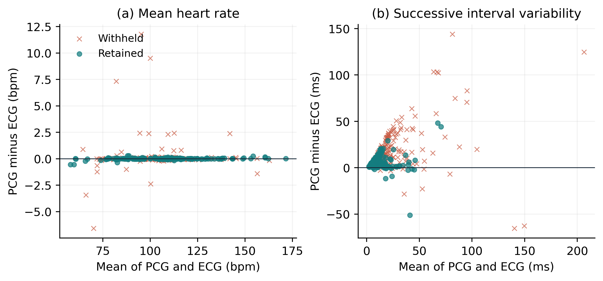
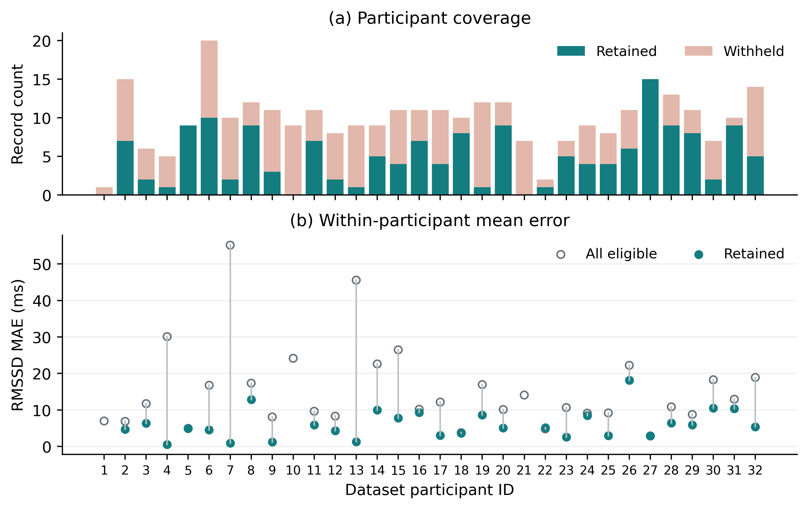
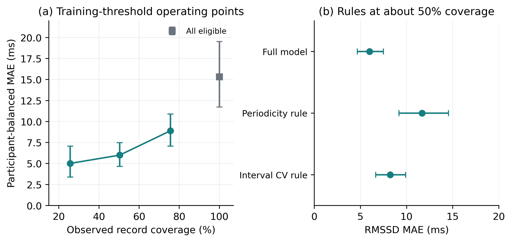
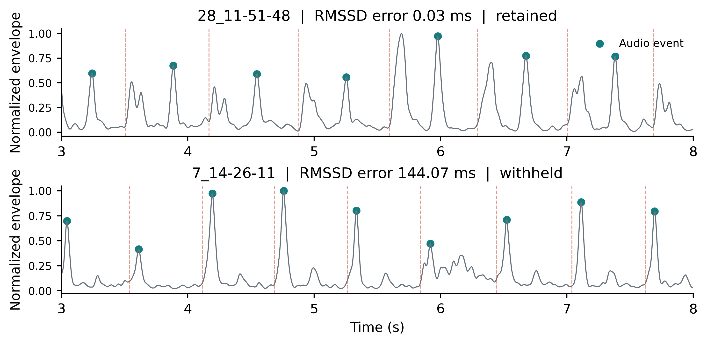

# Participant Held Out Quality Gating for Ultra Short Heart Sound Variability Estimation

Pallab Sarangi (1), Shreyas Baloni (2), Pooja R Rao (1)

(1) Department of CSE (Data Science), RNS Institute of Technology, Bengaluru, India

(2) Department of Information Science and Engineering, RNS Institute of Technology, Bengaluru, India

**Abstract.** Accurate average heart rate does not ensure accurate beat-to-beat variability from heart sounds. We evaluated an audio-only quality gate against an automated electrocardiographic comparator using SensSmartTech 1.0.0: 338 synchronized recordings from 32 participants before activity and during recovery. Of these, 316 passed comparator and feature checks. Acoustic events were extracted without ECG input. Six acoustic features predicted log absolute RMSSD disagreement through ridge regression and leave-one-participant-out evaluation; thresholds used training participants only. Participant-balanced heart-rate mean absolute error was 0.28 bpm, whereas RMSSD error was 15.33 ms. At a nominal 50% retention target, the gate accepted 159 recordings from 29 participants, with RMSSD error of 6.00 ms (95% participant-bootstrap interval 4.66-7.48). The paired selection effect was -9.36 ms (-14.32 to -5.32); matched random retention yielded 15.36 ms. Post-hoc periodicity and interval-variability rules gave errors of 11.67 and 8.23 ms at similar coverage. The results support reporting error alongside coverage. Short windows, automated reference timing and untested external transfer preclude clinical HRV equivalence claims.

**Keywords:** Phonocardiography, RMSSD, selective estimation, signal quality, participant validation.

## 1 Introduction

Heart sounds provide mechanical timing without electrical electrodes. Variability estimation depends on locating repeated events consistently. Multimodal studies show that agreement in mean heart rate can coexist with limited agreement in heart-rate variability (HRV) indices [1]. An acoustic system therefore needs to identify when an estimate should be withheld.

We evaluate this selective estimation decision on participants excluded from training, reporting retained-record error, recording and participant coverage, and a random-retention control. The experiment concerns ultra-short sensor agreement during rest and recovery. It does not test a disease biomarker or equivalence to conventional HRV.

<!-- page -->

## 2 Related Work and Study Data

### 2.1 Positioning within existing research

Quality assessment is established in phonocardiography (PCG). Springer et al. trained classifiers against expert quality labels [2], while Giordano et al. investigated signal-to-noise-based assessment [3]. Template matching has also been applied to heart-sound localization in forcecardiography [4]. These studies motivate quality-aware processing but address different targets from predicting absolute RMSSD disagreement. A recent SensSmartTech study compares average heart-rate estimation across sensing modalities [5]. Table 1 identifies the narrower question examined here without asserting first-ever novelty.

**Table 1. Prior work and the scope of this experiment.**

| Work | Measurement or target | Relation to this study |
| --- | --- | --- |
| Charlier et al. [1] | Multimodal HRV comparison | Mean HR does not establish variability agreement |
| Springer et al. [2] | Expert PCG quality labels | Quality classification differs from RMSSD error prediction |
| Giordano et al. [3] | Signal-to-noise quality | Motivates acoustic quality features |
| Centracchio et al. [4] | Forcecardiographic sound localization | Different sensor and landmark method |
| Krsic et al. [5] | SensSmartTech mean HR | Same data context, different endpoint |
| Present experiment | RMSSD error and coverage | Participant-held-out gate and selection controls |

### 2.2 Dataset and analysis cohort

We used the complete, openly released SensSmartTech WFDB dataset, version 1.0.0 [6,7]. Recordings include synchronized ECG, PCG, photoplethysmography (PPG) and chest acceleration (ACC), resampled to a shared 1 kHz grid. Native sensor rates differ; resampling does not confer 1 ms timing accuracy. Dataset metadata identify before-activity and after-activity recordings. Table 2 gives the observed analysis flow. All downloaded signal and header files matched the upstream SHA256 manifest.

**Table 2. Source cohort and primary analysis flow.**

| Stage | Records | Participants |
| --- | --- | --- |
| Complete release | 338 | 32 |
| Before activity | 96 | 32 |
| After activity | 242 | 32 |
| ECG checks failed | 22 | - |
| Eligible for primary analysis | 316 | 32 |
| Retained by primary gate | 159 | 29 |

<!-- page -->

## 3 Signal Processing and Quality Features

### 3.1 Electrical comparator and acoustic events

ECG leads I and II were filtered at 5-25 Hz (third-order Butterworth, forward and backward), scaled to unit standard deviation, and independently processed with WFDB XQRS. Lead II supplied comparator times. Eligibility required cross-lead F1 at least 0.90 within 50 ms, at least 15 beats, and every interval between 0.30 and 1.50 s. Sequences excluded 0.5 s at each boundary. These checks cannot identify shared errors or establish normal-to-normal intervals.

PCG filtering used 25-150 Hz, followed by the absolute Hilbert transform and a 15 Hz envelope low-pass filter. Normalized envelope autocorrelation over lags of 333-1500 samples estimated a cycle period. A recurrence tracker selected candidate peaks within 0.65-1.35 estimated cycles of the preceding event. Its score combined log envelope height with a quadratic period-deviation penalty of weight eight. Missing candidates advanced the search by one cycle without creating a detected event. A peak-distance baseline required separation of 0.55 estimated cycles. Neither acoustic detector accessed ECG. Events are acoustic phase markers and are not verified S1 labels.

### 3.2 Interval metrics and gate inputs

For each modality, events in [2, 28) s defined the analysis window. At least ten intervals were required. For n intervals I in seconds, heart rate was 60 divided by their mean; interval SD used the sample standard deviation. RMSSD, in milliseconds, was defined as follows.

$$\mathrm{RMSSD}=1000\sqrt{\frac{\sum_{i=1}^{n-1}(I_{i+1}-I_i)^2}{n-1}}\qquad (1)$$

Table 3 lists the six audio-only gate inputs. Features describe the complete extracted event sequence; metric computation uses the inner window. Short-window RMSSD agreement is distinct from validation against a five-minute reference [8,9].

**Table 3. Acoustic inputs available at inference.**

| Feature | Definition in this implementation |
| --- | --- |
| Periodicity | Overlap-normalized envelope autocorrelation at estimated period |
| Morphology consistency | Mean inner product of centered, unit-norm 121-sample event envelopes with their average |
| Interval CV | Population SD divided by mean acoustic interval |
| Event-height CV | Population SD divided by mean detected envelope height |
| Detector disagreement | Absolute HR difference between recurrence and peak-distance detectors |
| Spectral ratio | Welch power in 25-150 Hz divided by total PCG power |

<!-- page -->

## 4 Participant Held Out Evaluation

### 4.1 Training and inference

For each of 32 folds, one participant was held out in full. Standard scaling and ridge regression (alpha = 10) were fitted to the other participants. The target was log(1 + absolute acoustic-minus-ECG RMSSD error). Training weights gave each participant equal total weight; the scaler and threshold quantile were record-weighted. A median of training predictions defined the primary retention threshold. Held-out predictions at or below that threshold were accepted. ECG supplied training targets and evaluation comparisons, but no inference input (Fig. 1).

**Fig. 1.** Cohort flow and separation of training, inference and ECG-guided diagnostics. The gate is learned from other participants; all test scores use frozen fold parameters.

### 4.2 Estimands and uncertainty

Mean absolute error (MAE) was averaged within participants, then across participants. Percentile intervals used 2,000 participant bootstrap resamples (seed 20261013). Gate effects paired retained- and all-record means for participants with accepted data. A random-retention control sampled without replacement 1,000 times, matching accepted counts within each retained participant. Its simulation interval differs from the gate's bootstrap interval.

Bootstrap intervals condition on saved predictions and omit model-refitting uncertainty. Pooled difference plots are descriptive. Single-feature rules, feature-removal fits and 25%/75% training-quantile thresholds were added after primary inspection and are explicitly post-hoc.

<!-- page -->

## 5 Results

### 5.1 Detector and modality comparisons

All 338 records were processed without extraction failure. Twenty-two failed ECG comparator checks, leaving 316 records from all 32 participants. Median absolute difference between extracted mean ECG heart rate and metadata median-based heart rate was 0.34 bpm; the two definitions need not coincide.

**Table 4. Participant-balanced MAE with 95% bootstrap intervals.**

| Method | Records | HR (bpm) | RMSSD (ms) |
| --- | --- | --- | --- |
| Acoustic recurrence | 316 | 0.28 (0.12-0.49) | 15.33 (11.72-19.52) |
| Acoustic peak baseline | 316 | 0.73 (0.38-1.15) | 43.89 (31.96-56.51) |
| ACC recurrence | 316 | 0.32 (0.16-0.53) | 29.66 (24.62-35.15) |
| Carotid PPG | 313 | 4.49 (3.02-6.13) | 129.69 (108.34-153.86) |
| Brachial PPG | 316 | 3.35 (2.00-4.75) | 86.26 (66.88-107.25) |
| ECG-guided PCG* | 316 | 0.05 (0.04-0.05) | 11.80 (9.87-14.13) |

*ECG-guided PCG is a timing diagnostic. PPG uses positive peaks after 0.5-8 Hz filtering; ACC uses recurrence after 10-40 Hz filtering. Carotid output is missing for three eligible records.

Acoustic recurrence gave a heart-rate MAE of 0.28 bpm but RMSSD MAE of 15.33 ms (Table 4). The simpler acoustic peak detector gave RMSSD MAE of 43.89 ms. This difference establishes sensitivity to the chosen detector within this experiment. PPG and ACC results come from simple fixed baselines and cannot rank the intrinsic accuracy of sensing technologies.

**Fig. 2.** Acoustic-minus-ECG differences against the mean of both measurements for (a) heart rate and (b) RMSSD. Each point is a recording. Colors and marker shapes identify the held-out gate decision. No inferential limits of agreement are asserted.

<!-- page -->

### 5.2 Primary retention result and participant coverage

The gate retained 159 of 316 eligible recordings (50.3%), or 47.0% of the source cohort. The paired comparison used 29 participants with accepted data; their all-record MAE was 15.36 ms. Table 5 separates the paired selection effect from the all-participant baseline.

**Table 5. Primary gate estimands and their denominators.**

| Set or comparison | Records | People | RMSSD MAE or change (ms) |
| --- | --- | --- | --- |
| All eligible | 316 | 32 | 15.33 (11.72-19.52) |
| All records in paired participants | 299 | 29 | 15.36 |
| Retained by primary gate | 159 | 29 | 6.00 (4.66-7.48) |
| Retained minus all, paired | - | 29 | -9.36 (-14.32 to -5.32) |
| Matched random retention | 159/run | 29 | 15.36 [11.64-19.61] |

Parentheses denote 95% participant-bootstrap intervals. Brackets denote the central 95% random-selection simulation range. The paired baseline is restricted to participants with retained records.

**Fig. 3.** Retained and withheld record counts (a), with participant-level RMSSD errors (b). Participants 1, 10 and 21 had no retained record and therefore have no retained-error point. Lines connect the two means only where both exist.

Matched random retention yielded MAE 15.36 ms (central 95% simulation range 11.64-19.61); none matched the gate's lower MAE. The corrected fraction was 1/1001. Selection does not repair rejected measurements. Accepted-record errors still reached a 95th percentile of 18.95 ms and maximum of 51.32 ms.

<!-- page -->

### 5.3 Post Hoc Rule Comparisons and Feature Removal

Every additional rule used training participants to determine its threshold. Higher periodicity and lower interval coefficient of variation (CV) were treated as favorable. The full model had lower descriptive retained-set error than either rule at approximately 50% coverage (Table 6). Their retained participants differ, so these summaries do not establish a paired superiority claim.

**Table 6. Post-hoc gates with nominal 50% retention targets.**

| Gate | Records | People | MAE, ms (95% interval) |
| --- | --- | --- | --- |
| Full model | 159 | 29 | 6.00 (4.66-7.48) |
| Periodicity rule | 158 | 29 | 11.67 (9.18-14.53) |
| Interval CV rule | 159 | 27 | 8.23 (6.65-9.90) |
| Remove periodicity | 158 | 29 | 6.20 (4.77-7.75) |
| Remove morphology | 156 | 28 | 7.09 (5.53-8.78) |
| Remove interval CV | 160 | 29 | 7.11 (5.29-9.17) |
| Remove height CV | 159 | 28 | 6.04 (4.67-7.57) |
| Remove detector difference | 159 | 29 | 6.18 (4.78-7.71) |
| Remove spectral ratio | 158 | 30 | 5.95 (4.48-7.58) |

**Fig. 4.** Post-hoc operating points from training-only thresholds (a) and simpler rule comparisons (b). Error bars are conditional 95% participant-bootstrap intervals. Connected points summarize distinct selection policies, not a calibrated clinical risk curve.

Removing morphology or interval CV raised MAE to about 7.1 ms. Without spectral ratio, MAE was 5.95 ms across 30 participants; all six features are not demonstrably necessary. Observed coverage at the 25% and 75% targets was 25.6% and 75.6%, with MAE 5.01 and 8.90 ms across 23 and 30 participants. No clinically optimal threshold is established.

<!-- page -->

### 5.4 Filtering Sensitivity and Timing Diagnostics

The alternative acoustic bands gave broadly similar RMSSD errors (Table 7). ECG-guided peaks searched 15-160 ms after R for an S1 proxy, with 25-120 ms and 0-200 ms sensitivity windows. S2 proxies used 180-500 ms, truncated before the next beat. Guided events are conditioned on ECG and therefore belong to a separate diagnostic branch, not a deployable audio-only comparison.

**Table 7. Filtering and guided-window sensitivities on 316 records.**

| Variant | RMSSD MAE, ms (95% interval) |
| --- | --- |
| PCG 25-150 Hz (primary) | 15.33 (11.72-19.52) |
| PCG 20-200 Hz | 16.52 (12.51-20.98) |
| PCG 40-120 Hz | 17.03 (13.04-21.41) |
| Guided 15-160 ms | 11.80 (9.87-14.13) |
| Guided 25-120 ms | 11.08 (9.26-13.35) |
| Guided 0-200 ms | 12.65 (10.34-15.58) |

**Fig. 5.** Five-second excerpts from the lowest and highest acoustic RMSSD-error recordings. Dots mark acoustic events and dashed lines mark automated ECG R events. The displayed envelope is normalized within each excerpt; errors use the complete analysis window. Selection is for error auditing, not population representation.

If an acoustic event Sᵢ occurs at Rᵢ + dᵢ, its interval differs from the electrical interval by dᵢ₊₁ - dᵢ. The implementation's matched-sequence identity residual was zero at stored precision. This verifies arithmetic consistency only. Observed delay includes physiological timing, filtering and localization error, which this experiment cannot separate.

Among 30 participants with before- and after-activity data, the after-minus-before MAE difference was 1.08 ms (95% interval -5.54 to 7.28), providing no evidence of a systematic exercise-related increase in error.

<!-- page -->

## 6 Discussion

The audio-only gate reduced retained-record disagreement on unseen participants, with substantial loss of coverage. A monitor that returns no value for some people cannot be characterized solely by successful-output accuracy. Source, eligible and participant-specific denominators make that limitation visible.

The random-retention control preserves participant composition and accepted counts. It does not remove all selection bias: accepted recordings may have lower physiological variability or easier acoustic morphology. Interval CV is related to estimated variability, so its predictive usefulness may partly reflect the endpoint's scale. The present data cannot distinguish these explanations causally.

Feature removal does not identify a uniquely necessary six-feature set. The benchmark needs comparison with stronger landmarks, including logistic-regression hidden semi-Markov segmentation [10], before attributing the tradeoff to a general property of acoustic monitoring.

### 6.1 Limitations and next validation steps

The effective window is approximately 26 s, and recovery can be nonstationary. Findings on ultra-short ECG recordings [8] do not establish equivalence for acoustic landmarks under this protocol. We make no spectral HRV, autonomic-state, disease-classification or blood-pressure claim. The cohort is small, uses one acquisition setup, and contains repeated measurements. No external test cohort or confirmatory preregistration was used.

ECG lacks expert beat adjudication, cross-lead agreement can miss shared mistakes, and acoustic phase is unlabeled. Future work should obtain blinded ECG and S1/S2 annotations, quantify annotator agreement, and repeat the endpoint analysis. Longer recordings such as EPHNOGRAM [11] offer a route to external validation, which has not been performed. Confidence intervals exclude model-refitting uncertainty; post-hoc feature comparisons require confirmation before selecting a final gate.

## 7 Conclusion

In this 32-participant exploratory benchmark, acoustic mean-heart-rate agreement was much stronger than RMSSD agreement. A participant-held-out quality gate retained 50.3% of eligible recordings with RMSSD MAE of 6.00 ms, compared with 15.33 ms across all eligible recordings. Its value is an explicit error-and-coverage tradeoff. Independent annotation, stronger detector baselines and external replication remain necessary before interpreting the approach as clinically reliable variability monitoring.

<!-- page -->

**Data and research transparency.** SensSmartTech [6] is available through PhysioNet [12] under CC BY 4.0. Original ethics approval is documented by the dataset authors; this secondary analysis asserts no local exemption. Code and results: https://github.com/above-avg/auditory-biomarkers. Primary revision: 7f8686f; post-hoc additions reproduce its predictions. The protocol was not publicly preregistered. Generative AI assisted coding, analysis, drafting and figures. The named authors remain responsible for verification and approval.

## References

1. Charlier, P., Cabon, M., Herman, C., et al.: Comparison of multiple cardiac signal acquisition technologies for heart rate variability analysis. Journal of Clinical Monitoring and Computing 34(4), 743-752 (2020). https://doi.org/10.1007/s10877-019-00382-0

2. Springer, D.B., Brennan, T., Ntusi, N., et al.: Automated signal quality assessment of mobile phone-recorded heart sound signals. Journal of Medical Engineering & Technology 40(7-8), 342-355 (2016). https://doi.org/10.1080/03091902.2016.1213902

3. Giordano, N., Rosati, S., Knaflitz, M.: Automated Assessment of the Quality of Phonocardographic Recordings through Signal-to-Noise Ratio for Home Monitoring Applications. Sensors 21(21), 7246 (2021). https://doi.org/10.3390/s21217246

4. Centracchio, J., Parlato, S., Esposito, D., et al.: Accurate Localization of First and Second Heart Sounds via Template Matching in Forcecardiography Signals. Sensors 24(5), 1525 (2024). https://doi.org/10.3390/s24051525

5. Krsic, J., Stojanovic, M.G., Miletic, M., et al.: Heart Rate Estimation by Different Sensing Modalities under Resting and Post-Exercise-Recovery Conditions. IEEE Sensors Journal, early access (2026). https://doi.org/10.1109/JSEN.2026.3726629

6. Lazovic, A., et al.: SensSmartTech database of cardiovascular signals synchronously recorded by an electrocardiograph, phonocardiograph, photoplethysmograph and accelerometer. Version 1.0.0. PhysioNet (2024). https://doi.org/10.13026/fy9p-n277

7. Lazović, A., Atanasoski, V., Tadić, P., et al.: Synchronous post-exercise electrocardiogram, phonocardiogram, photoplethysmograms and seismocardiogram. Scientific Data 12(1), 1452 (2025). https://doi.org/10.1038/s41597-025-05781-4

8. Munoz, M.L., van Roon, A., Riese, H., et al.: Validity of (Ultra-)Short Recordings for Heart Rate Variability Measurements. PLOS ONE 10(9), e0138921 (2015). https://doi.org/10.1371/journal.pone.0138921

9. Task Force of the European Society of Cardiology and the North American Society of Pacing and Electrophysiology: Heart rate variability. Standards of measurement, physiological interpretation, and clinical use. European Heart Journal 17, 354-381 (1996). https://doi.org/10.1093/oxfordjournals.eurheartj.a014868

10. Springer, D.B., Tarassenko, L., Clifford, G.D.: Logistic regression-HSMM-based heart sound segmentation. IEEE Transactions on Biomedical Engineering 63(4), 822-832 (2016). https://doi.org/10.1109/TBME.2015.2475278

11. Kazemnejad, A., Gordany, P., Sameni, R.: EPHNOGRAM: A simultaneous electrocardiogram and phonocardiogram database. Version 1.0.0. PhysioNet (2021). https://doi.org/10.13026/tjtq-5911

12. Pollard, T., Moody, B.E., Lehman, L., et al.: PhysioNet as a global platform for biomedical research. Nature Health 1, 792-795 (2026). https://doi.org/10.1038/s44360-026-00096-z
